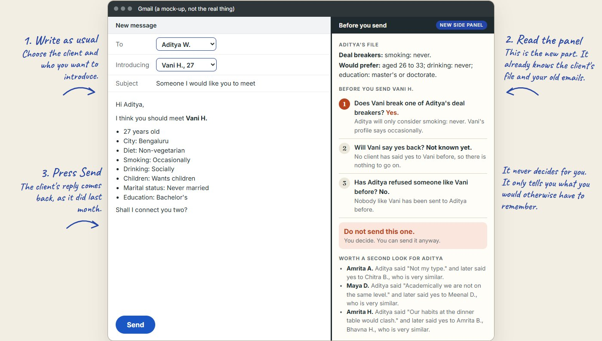
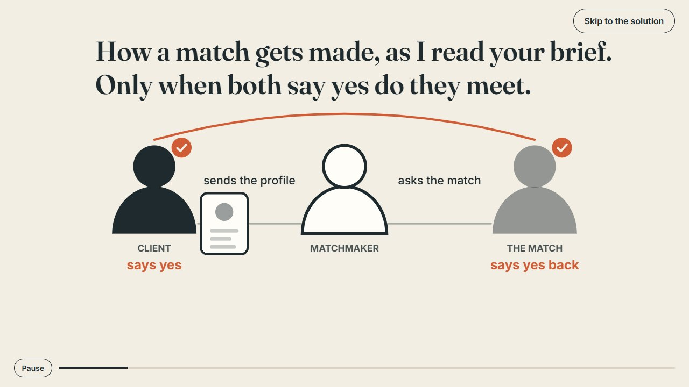
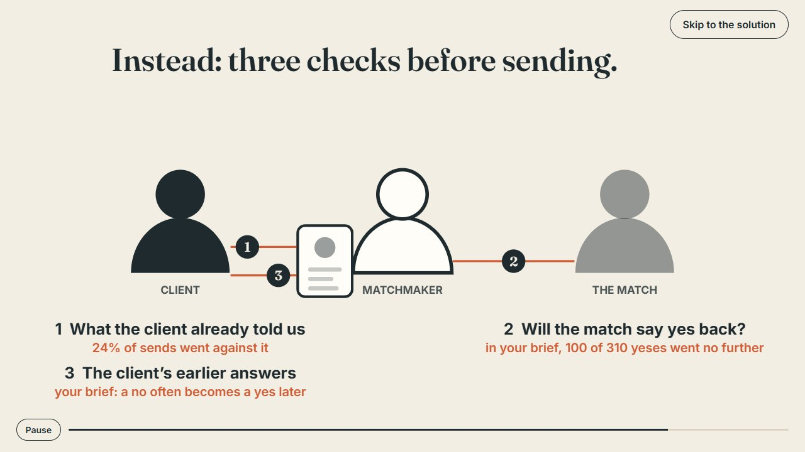

# Before you send

Prototype and evidence for The Date Crew product growth assessment. Written answers are in
[ANSWERS.md](ANSWERS.md).



| How a match gets made | The three checks |
|---|---|
|  |  |

The problem it targets: only 21 of every 100 profiles sent end in a mutual yes (210 of 1,000 in the
brief). Before a profile goes to a client, the matchmaker sees three facts that are already in the inbox:

1. **Preferences.** Does the profile break a deal breaker (blocked) or a softer preference (warning)?
2. **Their side.** When clients said yes to this person before, how often did they say yes back?
3. **Client history.** Has this client passed on or accepted similar profiles?

Plus a **second look** list: profiles a client passed on without a specific reason that resemble ones
they accepted later. There is no score, and nothing is chosen for the matchmaker.

## Run it

Serve the folder with any static server (for example `python -m http.server`) and open it. There is no build step.

- `index.html` - an 80-second animated story of how I got to the answer, then the solution in one page
- `prototype.html` - the tool itself: pick a client and a profile, read the note, compare it with what happened

```
node data/generate.js   # regenerate the mocked data (seeded, reproducible)
node test.js            # unit tests, plus the replay numbers
```

## The mocked data

`data/generate.js` builds 40 clients, a pool of 300 profiles and a 30-day log of 1,000 sends that matches
the brief's funnel: 310 accepted, 210 contact details shared, matchmaker A at 44%, B at 21%, 35% of
rejections avoidable. Everything the brief does not state is an assumption, listed at the top of the
generator.

The patterns in the replay exist because the generator put them there, so the prototype shows how the
tool behaves, not that the ideas work. The evidence for the ideas is in `analysis/`.

## Evidence

Two quick tests run before choosing what to build. Details and limits are in ANSWERS.md.

- `analysis/speed-dating/` - on 8,368 real speed-dating decisions, do stated preferences or past choices
  predict who people say yes to? Output in `results.txt`.

  ```
  node analysis/speed-dating/fetch.mjs "https://www.stat.columbia.edu/~gelman/arm/examples/speed.dating/Speed%20Dating%20Data.csv" analysis/speed-dating/speed.csv
  uv run --no-project --with pandas --with scikit-learn --with scipy python analysis/speed-dating/analyze.py analysis/speed-dating/speed.csv
  ```

- `analysis/embedding-traits/` - can EmbeddingGemma 2, running locally, see visible traits in a profile
  photo and learn a preference from three yes and three no examples? `vectors.json` holds the embeddings
  of 60 generated faces (the images are not in the repo); `analyze.mjs` scores them against labels
  assigned by eye. Output in `results.txt`.

## Files

- `checker.js` - the three facts, second look, the keyword reason parser, and the replay
- `app.js`, `prototype.html` - the prototype UI
- `film.js`, `index.html` - the story film (one canvas; every frame is a pure function of time) and the solution page
- `data/generate.js` - mocked data generator
- `test.js` - tests
